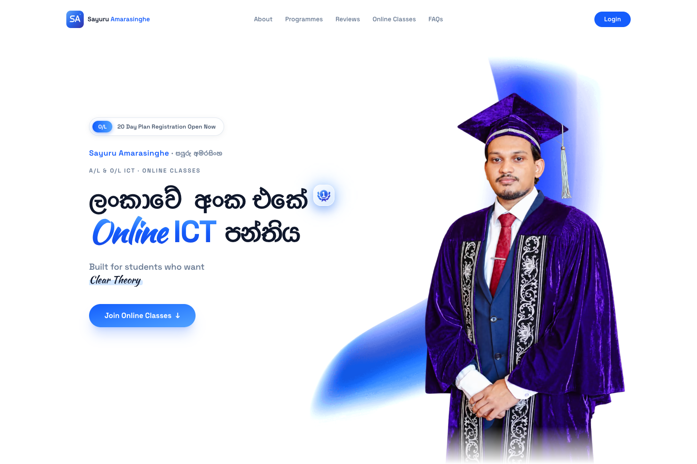
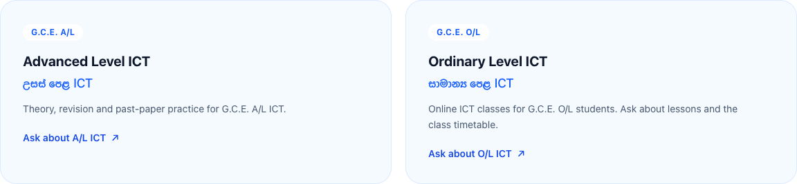
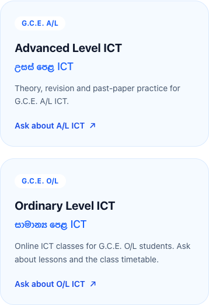
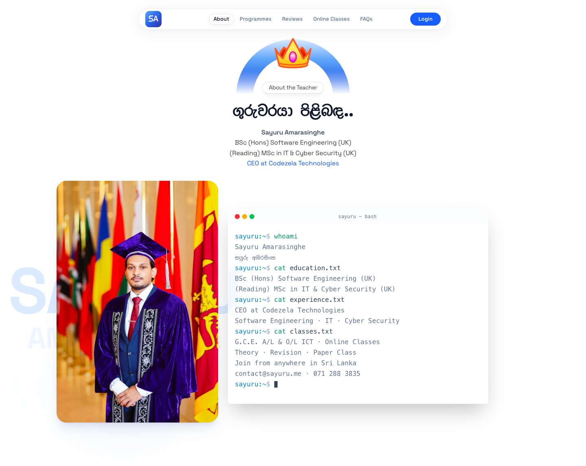
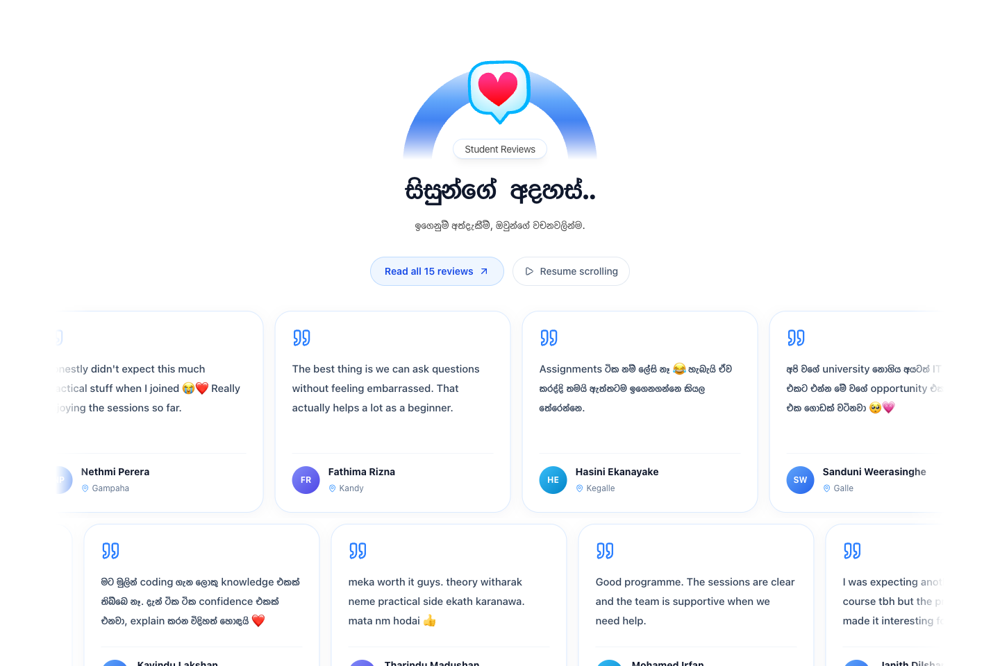
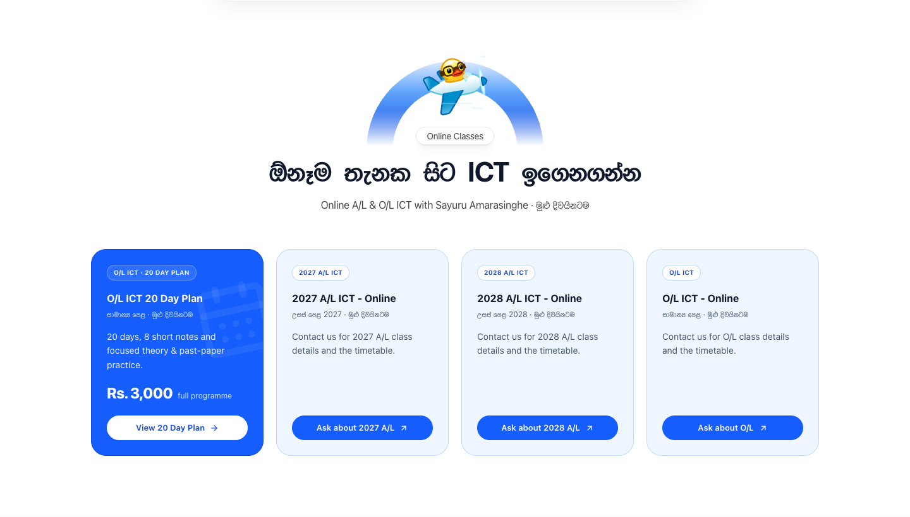
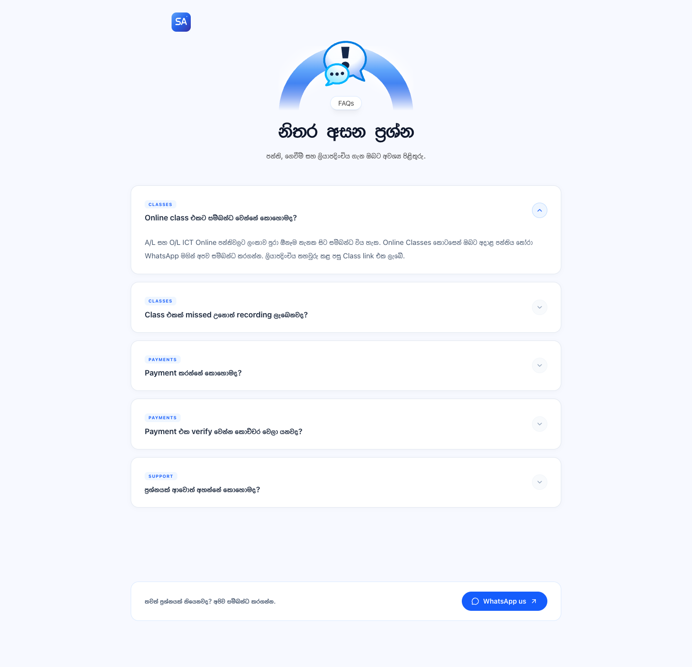

<div align="center">
  
  <h1>ICT with Sayuru</h1>
  <p><strong>A/L &amp; O/L ICT with Sayuru Amarasinghe</strong></p>
  <p>සයුරු අමරසිංහ සමඟ ICT ඉගෙනගන්න · Online classes across Sri Lanka</p>
  <p>
    <a href="#screenshots">Screenshots</a> ·
    <a href="#quick-start">Quick start</a> ·
    <a href="#project-guide">Project guide</a> ·
    <a href="#deploy-to-vercel">Deploy</a> ·
    <a href="AGENTS.md">Agent instructions</a>
  </p>
  <p><code>Next.js 15</code> <code>React 19</code> <code>TypeScript</code> <code>Tailwind CSS 4</code> <code>Node.js 24</code></p>
</div>



A responsive, bilingual ICT tuition website with A/L and O/L programmes, online class enquiries, an animated teacher profile, student reviews and direct contact options. Built around Sayuru's identity, graduation photograph and professional background.

**Website domain:** [ict.sayuru.me](https://ict.sayuru.me) · **Repository:** [sayuru-akash/ict-with-sayuru](https://github.com/sayuru-akash/ict-with-sayuru)

> This is the public tuition website. WhatsApp registration and a feedback email draft are available; the student login is a preview. A dashboard, payments, recordings and marks tracking are not implemented in this frontend.

## Contents

- [Screenshots](#screenshots)
- [What the website includes](#what-the-website-includes)
- [Quick start](#quick-start)
- [Commands and checks](#commands-and-checks)
- [Configuration](#configuration)
- [Project guide](#project-guide)
- [Content and visual assets](#content-and-visual-assets)
- [SEO and discovery](#seo-and-discovery)
- [Deploy to Vercel](#deploy-to-vercel)
- [Verification and current limits](#verification-and-current-limits)
- [Working with agents](#working-with-agents)

## Screenshots

Real browser captures of the local production build, refreshed on **1 November 2026**, with the homepage, teacher profile, online classes, student reviews, FAQs and campaign promotion updated on **3 November 2026**. Documentation images live in [`docs/screenshots/`](docs/screenshots/); the separate `public/screenshots/` images are used by the web manifest.

### A/L and O/L programmes



### Mobile experience

<table>
  <tr>
    <td align="center" valign="top" width="50%">
      <strong>Landing page</strong><br /><br />
      
    </td>
    <td align="center" valign="top" width="50%">
      <strong>Programme choices</strong><br /><br />
      
    </td>
  </tr>
</table>

<details>
<summary><strong>More previews: teacher profile, student reviews, online classes and FAQs</strong></summary>

### Teacher profile

The supplied square graduation photo sits beside an animated terminal displaying the teacher's qualifications, current studies and professional role.



### Campaign popup promotion

The generated study illustration sits beside live programme details in a dismissible popup. It appears after four seconds on public pages, once per session, and can be reopened with the floating campaign button.


### Student reviews

The 15 supplied reviews keep their original wording, student names and cities. Scrolling rows can be paused, and the read-all dialog shows every full review. Reduced-motion preferences stop automatic scrolling.



### Online classes

Every public page highlights the campaign in a popup ad after four seconds, once per browsing session. The floating “20 Day F to A Plan” button can reopen it at any time. It waits while another dialog is open or a form field is being edited. The ad, hero registration notice and plan popup all link to [the campaign registration URL](https://wa.link/1qdj47).

The O/L 20 Day Plan appears first, with a programme popup covering its Rs. 3,000 total fee, eight short notes, theory sessions and past-paper practice. Regular 2027 A/L, 2028 A/L and O/L cards open WhatsApp enquiries for details and timetables.



### FAQs and support



</details>

## What the website includes

| Experience | Implementation |
| --- | --- |
| Personal branding | Sayuru's portrait, SA monogram, qualifications, Codezela role and contact links |
| Programmes | Separate A/L and O/L ICT cards with contextual WhatsApp enquiries |
| Learning features | Theory and revision, paper practice and the 20 Day Plan |
| Teacher profile | Updated square graduation photograph and an automatically typed terminal presentation |
| Online classes | O/L 20 Day Plan details and registration, plus 2027 A/L, 2028 A/L and O/L timetable enquiries |
| Programme promotion | Dismissible 20 Day F to A Plan ad after four seconds, once per session, with a shared campaign WhatsApp link |
| Student reviews | 15 owner-supplied reviews with names and cities, pausable scrolling rows and a read-all dialog |
| FAQs and feedback | Wide FAQ accordion with WhatsApp support; separate feedback form with validation, rating and an email draft |
| Navigation | Desktop navigation, a mobile menu and Lenis anchor scrolling |
| Policies | Privacy, terms and conditions, and refund pages with shared layout and contact details |
| App presentation | Manifest, favicons, install icons, browser-dependent installation guidance and saved cookie preferences |
| Search and sharing | Route-specific metadata, JSON-LD, social previews, sitemap and crawler directives |

**Owner-approved content boundaries:** keep both A/L and O/L, preserve the 15 replacement reviews exactly as supplied, and keep the student results section removed. `Results.tsx` and its dataset remain unused source files, not a published section.

## Quick start

### Requirements

- **Node.js 24.x**, as declared in `.nvmrc` and `package.json`.
- **npm** with the committed `package-lock.json`.
- A free local port. Use an already-running preview when appropriate.

```sh
git clone https://github.com/sayuru-akash/ict-with-sayuru.git
cd ict-with-sayuru

# If you use nvm
nvm use

npm ci
npm run dev -- --hostname 127.0.0.1 --port 3107
```

Open **[http://127.0.0.1:3107](http://127.0.0.1:3107)**. No environment variables are required for the public website. Without the host/port flags, `npm run dev` uses Next.js defaults, normally port 3000.

### Run a production build locally

```sh
npm run build
npm start -- --hostname 127.0.0.1 --port 3107
```

Stop a development server using this checkout before building, or use an isolated build copy. Development and production builds share `.next`; do not overwrite a running server's build output.

## Commands and checks

| Command | Purpose |
| --- | --- |
| `npm ci` | Install exactly the locked dependency graph |
| `npm run dev` | Start the development server |
| `npm run lint` | Run Next/TypeScript ESLint rules with zero warnings allowed |
| `npm run typecheck` | Run TypeScript without emitting JavaScript |
| `npm run build` | Create the production build, including lint and type checks |
| `npm start` | Serve an existing production build |
| `npm run check:seo -- http://127.0.0.1:3107` | Verify the running site's HTTP and SEO contracts |
| `npm audit --omit=dev` | Audit the production dependency graph |
| `git diff --check` | Detect whitespace errors before committing |

The SEO check covers all four public pages, unique metadata, canonical and social URLs, social image availability, one H1 per page, identity and structured data, both programmes, retained reviews, absent results, sitemap, robots and authentication `noindex` behavior.

There is no dedicated unit-test or browser-test runner configured in `package.json`. For UI changes, supplement these commands with real desktop/mobile checks of the affected flow, browser errors, broken assets and overflow.

## Configuration

[`src/lib/site.ts`](src/lib/site.ts) is the main source for public identity and contact settings. Optional environment values are listed in [`.env.example`](.env.example).

```sh
cp .env.example .env.local
```

| Variable | Default or behavior |
| --- | --- |
| `NEXT_PUBLIC_SITE_URL` | Defaults to `https://ict.sayuru.me`; used for canonical, sitemap and structured-data URLs |
| `NEXT_PUBLIC_API_URL` | Unset by default; keeps login in preview and prevents requests to an unconfigured backend |
| `GOOGLE_SITE_VERIFICATION` | Optional Search Console verification token |
| `BING_SITE_VERIFICATION` | Optional Bing verification token |

Set the API value to an **owned backend origin**, without a trailing `/api` path. Helpers append paths such as `/api/auth/me`. Public environment values and static metadata must be set before building; rebuild after changing them. Keep `.env.local` and `.vercel/` untracked.

### Teacher identity

| Field | Approved value |
| --- | --- |
| Name | Sayuru Amarasinghe / සයුරු අමරසිංහ |
| Qualification | BSc (Hons) Software Engineering (UK) |
| Current studies | (Reading) MSc in IT & Cyber Security (UK) |
| Role | CEO at Codezela Technologies |
| Email | [contact@sayuru.me](mailto:contact@sayuru.me) |
| Phone / WhatsApp | [071 288 3835](https://wa.me/94712883835) |
| Facebook | [facebook.com/ict.sayuru.me](https://www.facebook.com/ict.sayuru.me) |

The MSc is ongoing, not a completed qualification. The website's public contact details are intentional content, not secret environment values.

## Project guide

```text
ict-with-sayuru/
├── AGENTS.md                 Agent workflow and project constraints
├── README.md                 Project overview and maintainer guide
├── docs/screenshots/         README gallery, not served by the app
├── public/                   Portraits, fonts, illustrations and local datasets
├── scripts/check-seo.mjs      HTTP/metadata verification
├── src/
│   ├── app/                  Routes, root layout, fonts, CSS, sitemap and robots
│   ├── components/           Landing sections and shared UI
│   ├── context/              Authentication state and preview login
│   ├── lib/                  Site settings, SEO, API helpers and utilities
│   └── types/                Custom tgs-player JSX declarations
├── .env.example              Optional configuration contract
├── eslint.config.mjs         Next/TypeScript lint rules
├── next.config.ts            Initial-head metadata and image behavior
└── package-lock.json         Reproducible npm dependency graph
```

### Routes and rendering

| Route | Responsibility |
| --- | --- |
| `/` | Server entry injects homepage JSON-LD, then renders the client landing-page composition |
| `/privacy-policy` | English privacy policy with its own metadata and breadcrumbs |
| `/refund-policy` | English refund content with its own metadata and breadcrumbs |
| `/terms-and-conditions` | Enrolment, programme fees, access, materials, conduct and consumer rights |
| `/auth/callback` | Optional backend OAuth code exchange; marked `noindex` |
| `/sitemap.xml` | Four public routes and homepage image references |
| `/robots.txt` | Crawl rules and the public sitemap location |

`src/app/layout.tsx` supplies self-hosted fonts, resource hints, site-wide structured data, authentication context, toasts and the campaign promotion on public pages. `HomePage.tsx` orders the landing sections and owns the Lenis root. Shared dialog, section-header and terminal components live in `src/components/ui/`.

### Where to make common changes

| Change | Start here |
| --- | --- |
| Name, qualifications, email, phone or Facebook | `src/lib/site.ts`, then check page-specific copy and metadata |
| Hero portrait or responsive image sizing | `Hero.tsx` and matching preload hints in `app/layout.tsx` |
| A/L and O/L programme cards | `Features.tsx`; keep matching course data in `lib/seo.ts` |
| Class enquiries and O/L 20 Day Plan | `ClassLocations.tsx`, `lib/programmes.ts` |
| Timed campaign promotion | `ProgrammePromotion.tsx`, mounted in the root layout on public routes; reset `sayuru:20-day-plan-promotion:v1` in session storage to preview again |
| Animated profile presentation | `AboutTeacher.tsx` and `ui/macbook-terminal.tsx` |
| Student reviews | `public/comments/comments.json` and `Testimonials.tsx` |
| FAQs, WhatsApp support or feedback | `Faqs.tsx` and `FeedbackSection.tsx` |
| Navigation / footer anchors | `Navbar.tsx`, `Footer.tsx` and matching section IDs |
| Search metadata or social preview | `lib/seo.ts`, `StructuredData.tsx` and the social image |
| Policy text | The relevant policy route and shared `PolicyLayout.tsx` |
| App name, icons or install screenshots | `public/manifest.webmanifest`, `public/logos/`, `Footer.tsx` |

## Content and visual assets

**Photography:** `sayuru-amarasinghe-profile.webp` is the supplied square graduation photograph used in About and person metadata. Its 480, 768 and 1071 pixel AVIF/WebP versions preserve the square composition without upscaling. The earlier `sayuru-amarasinghe-original.webp` photograph remains preserved. The transparent `sayuru-amarasinghe.webp` cutout is used in the hero and social card. Responsive AVIF and WebP variants reduce downloads. Portrait changes must preserve Sayuru's likeness; the generated cutout is not described as pixel-identical to the original.

**Promotion illustration:** `public/images/20-day-plan-promo` contains transparent 480 and 960 pixel AVIF/WebP variants of the generated study-kit artwork. Campaign text and pricing remain live HTML. See the [generation prompt and asset notes](docs/assets/20-day-plan-promotion.md).

**Branding and fonts:** `public/logos/sayuru-mark.svg` is the source SA monogram. Icons are local PNG/ICO variants. `src/app/fonts.css` defines the self-hosted English and Sinhala families; English font licenses are in `public/fonts/latin/`. TGS illustrations use the local player in `public/lib/`.

**Datasets:** `public/comments/comments.json` contains 15 owner-supplied reviews with `name`, `location` and `comment`. They are statically imported for initial rendering, so rebuild after changing the dataset; students' full quotes and cities appear in scrolling cards and a read-all dialog. Do not invent testimonials or present this dataset as newly verified. The unused results data and result component are preserved without rendering them.

**Screenshots:** keep documentation captures in `docs/screenshots/`. The app's install screenshots are separate files in `public/screenshots/`; if those change, update their declared dimensions in the manifest too.

## SEO and discovery

- Bilingual homepage title/description and distinct metadata for policy routes.
- Canonical URLs, Open Graph and Twitter previews based on the configured public origin.
- Metadata emitted in the initial HTML head through `htmlLimitedBots` configuration.
- Site-wide `EducationalOrganization`, `Person` and `WebSite` data, plus two homepage `Course` entries.
- The ongoing MSc appears in the profile description, not as an awarded credential.
- Legal page breadcrumbs, a public sitemap with image URLs and crawler-readable auth `noindex` tags.
- No fabricated review/rating markup, fake language-version URLs or FAQ rich-result promises.

Update the sitemap's content date when the corresponding public page content changes, not on every build. A documentation-only update does not change the site's publication date.

After deployment, verify ownership in Google Search Console and optionally Bing Webmaster Tools, submit `https://ict.sayuru.me/sitemap.xml`, and inspect the homepage. Search indexing, field performance and ranking depend on the deployed site and cannot be proven by a local audit score.

<details>
<summary><strong>SEO references and measurement notes</strong></summary>

See Google's [SEO Starter Guide](https://developers.google.com/search/docs/fundamentals/seo-starter-guide), [structured-data policies](https://developers.google.com/search/docs/appearance/structured-data/sd-policies), [course-list requirements](https://developers.google.com/search/docs/appearance/structured-data/course), [sitemap guidance](https://developers.google.com/search/docs/crawling-indexing/sitemaps/build-sitemap) and [documentation updates](https://developers.google.com/search/updates).

The site describes two courses. This does not establish eligibility for Google's course-list carousel, whose requirements include at least three courses. There is no promise of a particular search position or rich result.

Historical Lighthouse 13.5 mobile results from **27 October 2026**: SEO 100, accessibility 100, best practices 100, performance 81. FCP was 2.1 s, LCP 4.3 s, CLS 0 and total blocking time 70 ms. These remain dated local measurements, not live-user Core Web Vitals or a new audit for every commit.

</details>

## Deploy to Vercel

Push the intended commit to GitHub, then import **`sayuru-akash/ict-with-sayuru`** into your Vercel account.

| Setting | Value |
| --- | --- |
| Framework preset | Next.js |
| Production branch | `main` |
| Root directory | Repository root (`./`) |
| Node.js version | `24.x` |
| Install command | `npm ci` |
| Build command | `npm run build` |
| Output directory | Next.js default; no override |
| Domain | `ict.sayuru.me` |

1. Set optional environment values before the deployment build. Keep `NEXT_PUBLIC_API_URL` unset for the current public-site experience.
2. Deploy, connect the domain, enable HTTPS and redirect alternate public hostnames to the canonical one.
3. Run `npm run check:seo -- https://ict.sayuru.me` and check the deployed mobile/desktop flows.
4. Complete Search Console ownership and sitemap submission separately.

A local commit, a Git push, a successful build and a verified live deployment are separate outcomes. Writing documentation does not connect Vercel, change DNS or publish the site.

## Verification and current limits

**Campaign verification, 3 November 2026:** lint, TypeScript, production build and SEO checks passed for all four public pages. Browser checks covered delayed opening, session persistence, manual reopening, generated-image loading, dialog deferral and the campaign link at desktop and mobile sizes down to 320 pixels. Link activation was intercepted locally; no WhatsApp message was sent. The production audit reported zero findings; the full audit retained 14 moderate development-tooling advisories.

**Verified baseline, 1 November 2026:** clean dependency installation, zero-warning lint, TypeScript, production build, HTTP SEO checks and desktop/mobile smoke checks passed. The tests retained reviews and confirmed that student results were absent.

| Boundary | Current state |
| --- | --- |
| Registration | Hero scrolls to the class cards; WhatsApp links include programme-specific enquiry drafts |
| Contact / feedback | WhatsApp enquiries; feedback opens an email draft without confirming delivery or storing messages on a server |
| Teacher terminal | Animated profile presentation; no interactive shell or remote command execution |
| Login | Preview notification without an owned backend configuration |
| Student portal | Dashboard, payments, recordings and marks screens are not implemented |
| App installation | Manifest and platform-specific prompts; no offline service worker is implemented |
| Deployment | Vercel, DNS and search-account setup must be verified when actually performed |

Some retained FAQ and policy copy describes portal services and payment workflows. Review that content with the owner before launching those services; do not treat the copy as proof that they exist.

<details>
<summary><strong>Dependency and runtime notes</strong></summary>

The 1 November production dependency audit reported **zero vulnerabilities**. The full audit reported **14 moderate development-tool findings** through minimatch in the Next.js 15-compatible ESLint toolchain. Audit counts are time-sensitive; rerun the commands when checking a later release.

Next.js remains locked to 15.5.28. Its nested PostCSS dependency is overridden to 8.5.32; retain that override until an upstream compatible version includes the required fix. Do not use a forced major upgrade simply to silence an audit report. The native image lint rule is disabled intentionally for the site's explicit responsive image markup. The local TGS player has an existing deprecation warning.

</details>

## Working with agents

Read **[AGENTS.md](AGENTS.md)** before changing this project. It documents the implementation map, owner decisions, content and identity constraints, validation requirements, screenshot workflow, environment boundaries and Git/deployment expectations.

For maintenance, keep changes scoped, follow the checks for the affected area, and update the documentation when commands or behavior change. Keep operational instructions for coding agents in `AGENTS.md`.

A repository-wide project license has not been declared. The bundled font licenses in `public/fonts/latin/` are retained separately; do not infer a project license from them.
