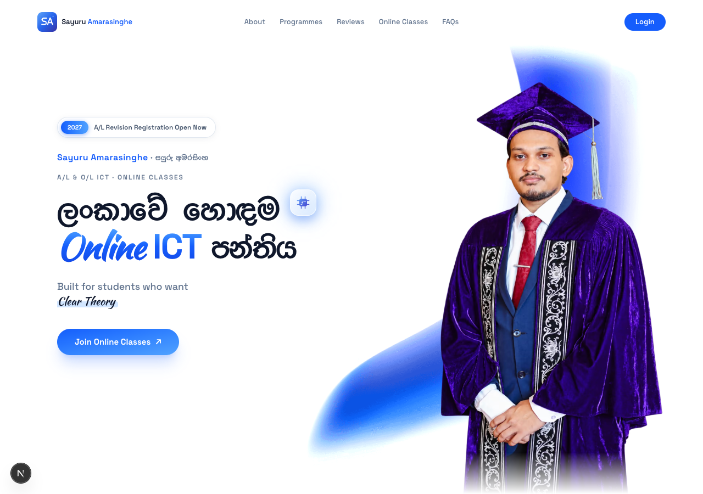

# Sayuru Amarasinghe | A/L & O/L ICT

Online G.C.E. Advanced Level and Ordinary Level ICT classes with **Sayuru Amarasinghe** in Sri Lanka.

**Production domain:** [ict.sayuru.me](https://ict.sayuru.me)  
**Local preview:** [127.0.0.1:3107](http://127.0.0.1:3107)

The local link works while the development server is running. The production domain is configured in the project; deployment is a separate step.

## Teacher and contact details

- **Name:** Sayuru Amarasinghe (සයුරු අමරසිංහ)
- **Qualification:** BSc (Hons) Software Engineering (UK)
- **Current studies:** (Reading) MSc in IT & Cyber Security (UK)
- **Role:** CEO at Codezela Technologies
- **Email:** [sayuru@codezela.com](mailto:sayuru@codezela.com)
- **Phone:** [071 288 3835](tel:+94712883835)
- **WhatsApp:** [Class registration](https://wa.me/94712883835)
- **Facebook:** [ICT with Sayuru](https://www.facebook.com/ict.sayuru.me)

## Website features

- Sinhala and English content with responsive desktop, tablet and mobile layouts.
- A/L and O/L ICT programme cards and WhatsApp registration links.
- Existing A/L online schedules for the 2026, 2027 and 2028 batches.
- O/L timetable enquiries through WhatsApp. No O/L days, times or fees are invented.
- Original graduation photo in About and a transparent portrait in the hero.
- Teacher terminal showing qualifications, current studies, professional role and contacts.
- Theory, revision, paper practice and other existing programme features.
- Student review marquee, FAQs, contact form and feedback dialog.
- Privacy and refund pages, cookie preferences, favicons and app installation metadata.

The student results section and its navigation links have been removed. Its original component and dataset remain as unused source files. Existing student reviews are retained at the owner's request for later replacement; the two teacher name references were updated with the branding. Reviews are not used to create search-engine rating or review claims.

## Screenshots

| Desktop | Mobile |
| --- | --- |
|  |  |

## Technology

Next.js 15 App Router, React 19, TypeScript, Tailwind CSS v4, Framer Motion, Lenis, Radix UI, Lucide icons and Sonner notifications. Sinhala and English fonts and illustration assets are served locally. The English font licenses are included in `public/fonts/latin/`.

## Local development

Use a Node.js version compatible with the installed Next.js package (`^18.18.0 || ^19.8.0 || >=20.0.0`) and npm. `package-lock.json` records the dependency versions.

```sh
npm ci
npm run dev -- --hostname 127.0.0.1 --port 3107
```

Open [http://127.0.0.1:3107](http://127.0.0.1:3107). `npm run dev` without flags uses Next.js's default port, 3000.

## Validation and production build

```sh
# Type checking
npx tsc --noEmit

# SEO checks against a running local server
npm run check:seo -- http://127.0.0.1:3107

# Optimized production build
npm run build

# Serve the production build
npm start
```

The SEO check verifies route responses, distinct titles and descriptions, canonical URLs, Open Graph and Twitter previews, social image availability, one primary heading per public page, structured data, A/L and O/L content, preserved reviews, removal of student results, sitemap and authentication noindex rules. The build enforces TypeScript checks; ESLint is currently skipped by `next.config.ts`.

Avoid running a production build against the same `.next` directory as an active development server. Use a separate checkout or build copy if the preview needs to stay available.

## Local verification, 27 October 2026

TypeScript, the production build, and the HTTP SEO checks passed. Browser checks covered 320, 390, 768, 1024 and 1440 pixel widths, programme navigation, A/L dialogs, O/L WhatsApp destinations, and retention of reviews with the results section absent. No horizontal page overflow or browser errors were observed.

A Lighthouse 13.5 mobile audit against the local production build reported:

| Category | Score |
| --- | --- |
| SEO | 100/100 |
| Accessibility | 100/100 |
| Best practices | 100/100 |
| Performance | 81/100 |

Measured mobile lab metrics were FCP 2.1 s, LCP 4.3 s, CLS 0, and total blocking time 70 ms. Self-hosted fonts and responsive AVIF images improved the performance score from 73 to 81 in this local comparison. Remaining performance costs include the animation runtime and JavaScript work. These are local lab measurements, not deployed field data, a search ranking score, or proof of indexing. One existing animation-player deprecation warning remains.

## Configuration

Personal details are centralized in [`src/lib/site.ts`](src/lib/site.ts). Copy `.env.example` to `.env.local` when overriding defaults:

```env
NEXT_PUBLIC_SITE_URL=https://ict.sayuru.me
# NEXT_PUBLIC_API_URL=https://your-owned-backend-origin
# GOOGLE_SITE_VERIFICATION=your-verification-token
# BING_SITE_VERIFICATION=your-verification-token
```

Set `NEXT_PUBLIC_API_URL` to the backend origin without a trailing `/api` path. API paths are appended by the application. Public environment variables are included at build time, so rebuild after changing them.

The Google and Bing verification values are optional tokens supplied by your own search engine accounts, not fabricated values. They are emitted as verification meta tags only when configured.

## SEO implementation

The search focus is Sayuru Amarasinghe, සයුරු අමරසිංහ, online A/L ICT classes, online O/L ICT classes and ICT tuition in Sri Lanka.

- Bilingual homepage title and description matching the actual programmes.
- Distinct metadata for the homepage, privacy page and refund page.
- Absolute canonical URLs and complete Open Graph/Twitter previews on every public page.
- Metadata included in the initial HTML head for crawlers and link-preview clients.
- A Sinhala page language with English language annotations for legal content and programme descriptions.
- Server-rendered content and JSON-LD, with two courses on the homepage only.
- EducationalOrganization, Person and WebSite data grounded in the supplied teacher details.
- Current MSc studies described as reading, rather than a completed credential.
- Legal page WebPage data and Home-to-page breadcrumbs.
- A sitemap containing the three public routes and homepage image URLs.
- An accurate content update date instead of a new sitemap date on every build.
- Authentication callback pages marked `noindex`; crawlers can read that directive.
- Responsive AVIF/WebP portraits with a matching hero preload and lazy-loaded About photo.
- Self-hosted fonts and a preloaded Sinhala heading font to reduce external render-blocking requests.
- No fabricated ratings, review schema, unsupported language-version links or retired FAQ rich-result markup.

Structured data helps describe the content. It does not guarantee a rich result or a ranking position. The two-course markup is not presented as qualifying for Google's course-list carousel, which requires at least three courses and additional conditions.

Reference guidance: [SEO Starter Guide](https://developers.google.com/search/docs/fundamentals/seo-starter-guide), [title links](https://developers.google.com/search/docs/appearance/title-link), [structured data policies](https://developers.google.com/search/docs/appearance/structured-data/sd-policies), [course-list requirements](https://developers.google.com/search/docs/appearance/structured-data/course), [sitemaps](https://developers.google.com/search/docs/crawling-indexing/sitemaps/build-sitemap), and [FAQ rich-result retirement](https://developers.google.com/search/updates).

## Forms and student portal status

The contact and feedback forms validate input and open the visitor's email app with a prepared message to `sayuru@codezela.com`. Opening that draft does not send it automatically. Programme and class links open WhatsApp for `+94712883835`.

Login displays a preview notification when no backend is configured. OAuth callback and API helpers are present, but the student dashboard, payments, recordings and marks screens are not implemented in this frontend. Connecting a backend alone does not create those screens. Existing FAQ and policy references to portal services describe the retained content and need review before those services are launched.

## Main files

| Location | Purpose |
| --- | --- |
| `src/app/page.tsx` | Server homepage entry and course structured data |
| `src/components/HomePage.tsx` | Landing page composition and smooth scrolling |
| `src/lib/site.ts` | Name, qualifications, role, contacts and public origin |
| `src/lib/seo.ts` | Shared page metadata and structured data |
| `src/components/StructuredData.tsx` | JSON-LD serialization with safe escaping |
| `src/components/Hero.tsx` | Hero portrait, programme label and registration link |
| `src/components/Features.tsx` | A/L and O/L programmes and learning features |
| `src/components/AboutTeacher.tsx` | Original photo and teacher terminal |
| `src/components/ClassLocations.tsx` | A/L schedules and O/L class enquiry |
| `public/comments/comments.json` | Retained student reviews |
| `src/app/privacy-policy/page.tsx` | Privacy policy and terms |
| `src/app/refund-policy/page.tsx` | Refund policy |
| `src/app/auth/layout.tsx` | Authentication indexing restrictions |
| `src/app/sitemap.ts` | Public route and image sitemap |
| `src/app/robots.ts` | Crawl rules and sitemap location |
| `public/manifest.webmanifest` | Installation name, icons, screenshots and shortcuts |
| `scripts/check-seo.mjs` | Repeatable HTTP SEO checks |

## Photos and branding

- `public/images/sayuru-amarasinghe-original.webp`: optimized supplied graduation photo with its original face and setting.
- `public/images/sayuru-amarasinghe.webp`: transparent portrait derived using the built-in image generation tool.
- Responsive AVIF hero variants and the `-480.webp` and `-768.webp` fallback variants provide smaller portrait downloads.
- `public/images/sayuru-amarasinghe-social.webp`: 1200 x 630 social preview for A/L and O/L ICT.
- `public/logos/sayuru-mark.svg`: SA monogram, also rendered as browser and install icons.
- `public/screenshots/`: current desktop and mobile installation previews.

Portrait edit prompt: remove only the flags and indoor background; preserve Sayuru's face, facial structure, skin tone, eyes, hair, facial hair, expression, pose, hands, graduation cap, purple gown, embroidery, suit and tie; crop empty space above the cap; use a transparent background with natural edges and no added text. The ungenerated original photo remains in About; the cutout is used in the hero and social preview.

## Deployment and search indexing

1. Build and deploy using the Next.js preset, with `ict.sayuru.me` configured as the public domain and HTTPS enabled.
2. Set the production environment values before building. Keep the canonical domain consistent and redirect other public hostnames to it.
3. Run `npm run check:seo -- https://ict.sayuru.me` against the deployed site.
4. Verify ownership in Google Search Console using DNS or the optional verification token, then submit `https://ict.sayuru.me/sitemap.xml` and inspect the homepage URL.
5. Verify the site in Bing Webmaster Tools if desired and submit the same sitemap.
6. Check mobile page experience and Core Web Vitals on the deployed domain. Local tests do not establish live-user field performance.
7. Replace retained reviews with approved reviews and keep programmes, timetable information and teacher details current. Update the sitemap content date when the corresponding content changes.

No production deployment, Search Console ownership verification or sitemap submission is performed by editing this project. Search visibility depends on crawling, indexing, content quality, reputation and competition as well as the implementation.
